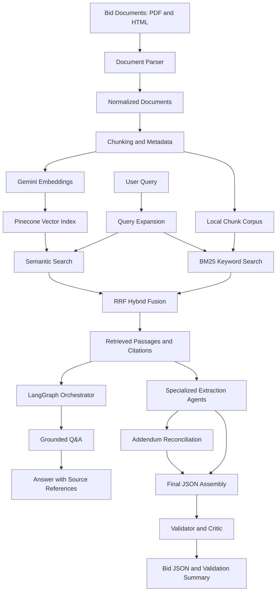

# RFP Intelligence Platform

A Python-based RFP intelligence system that ingests procurement documents, retrieves relevant passages using hybrid search, answers questions with source citations, and extracts structured bid information using specialized agents.

## 1. Project Overview

The platform currently supports two procurement bids:

- **Bid1:** Student and Staff Computing Devices
- **Bid2:** Dell Laptops with Extended Warranty

The system combines document parsing, chunking, embeddings, Pinecone retrieval, BM25 keyword search, Reciprocal Rank Fusion (RRF), LangGraph-based question answering, structured extraction, addendum reconciliation, and deterministic validation.

## 2. Key Features

- PDF and HTML document ingestion.
- Document metadata including bid ID, filename, document type, page number, and addendum metadata when available.
- Text chunking with overlap.
- Gemini embeddings with 768 dimensions.
- Pinecone vector search and BM25 keyword search.
- Hybrid retrieval using Reciprocal Rank Fusion.
- Query expansion for common procurement terminology.
- FastAPI endpoints for health checks, search, and question answering.
- LangGraph workflow for grounded question answering.
- Specialized extraction agents for logistics, commercial/legal requirements, product specifications, and bid identity/summary.
- Addendum reconciliation with source attribution.
- Final bid JSON containing 20 assignment fields.
- Citation metadata checks, automated tests, and retrieval evaluation.

## 3. Technology Stack

| Component | Technology |
|---|---|
| Language | Python |
| Package and environment manager | uv |
| Document parsing | PyMuPDF, pdfplumber, BeautifulSoup |
| Embeddings | Google Gemini Embeddings |
| Vector database | Pinecone |
| Keyword search | BM25 |
| Hybrid ranking | Reciprocal Rank Fusion |
| LLM | Groq, `openai/gpt-oss-20b` |
| Agent workflow | LangGraph |
| API | FastAPI |
| Data validation | Pydantic |
| Testing | pytest |

## 4. Architecture



The question-answering graph and the extraction/assembly pipeline have different responsibilities. The Q&A graph uses shared state to coordinate planning, retrieval, and answer generation. Specialized extraction modules produce field-level outputs, which the final assembly script merges and validates.

## 5. Repository Structure

```text
Emplay-assignment/
├── data/
│   ├── raw/
│   │   └── bid-documents/
│   │       ├── Bid1/
│   │       └── Bid2/
│   └── processed/
│       ├── normalized_documents.jsonl
│       └── chunks.jsonl
├── eval/
│   ├── questions.jsonl
│   ├── evaluate_retrieval.py
│   └── evaluation_results.json
├── outputs/
│   ├── Bid1_final.json
│   ├── Bid2_final.json
│   └── quality_check_report.json
├── src/emplay_assignment/
│   ├── agents/
│   ├── api/
│   ├── ingestion/
│   ├── schemas/
│   ├── search/
│   └── config.py
├── tests/
├── .env.example
├── .gitignore
├── pyproject.toml
├── uv.lock
└── README.md
```

The exact files in `outputs/` may vary depending on which individual agent commands have been executed.

## 6. Setup

### Prerequisites

- Python version supported by `pyproject.toml`.
- uv package manager.
- A Groq API key.
- A Gemini API key.
- A configured Pinecone index with the expected embedding dimension and vector field.

### Install dependencies

From the repository root:

```powershell
uv sync
```

Create a local environment file:

```powershell
Copy-Item .env.example .env
```

Set the following configuration in `.env` using your own credentials:

```dotenv
GROQ_API_KEY=your_groq_api_key
GEMINI_API_KEY=your_gemini_api_key
GROQ_MODEL=openai/gpt-oss-20b
EMBEDDING_MODEL=gemini-embedding-2
EMBEDDING_DIMENSION=768
PINECONE_API_KEY=your_pinecone_api_key
PINECONE_INDEX_NAME=emplay-assignment
PINECONE_NAMESPACE=rfp-bids
```

Do not commit `.env` or expose API credentials.

The index must use the configured dimension and the expected `emplay` dense-vector field. Check `config.py` and the index configuration before connecting to a different index.

## 7. Ingestion and Indexing

Set the source path for package imports in PowerShell:

```powershell
$env:PYTHONPATH = "src"
```

The ingestion pipeline has separate parsing, chunking, embedding, and indexing modules. If rebuilding the processed data or index, run the corresponding module entry points from the repository root:

```powershell
uv run python -m emplay_assignment.ingestion.parser
uv run python -m emplay_assignment.ingestion.chunker
uv run python -m emplay_assignment.search.indexer
```

Re-indexing makes external API calls and writes to Pinecone. Existing indexed data does not need to be rebuilt merely to run question answering or assemble the previously generated final JSON files.

## 8. Run the API

Start the FastAPI application:

```powershell
$env:PYTHONPATH = "src"
uv run uvicorn emplay_assignment.api.main:app --reload
```

Open the API documentation at:

`http://127.0.0.1:8000/docs`

Implemented routes include:

- `GET /health` — service health check.
- `POST /search` — retrieve document passages.
- `POST /ask` — answer a question using retrieved evidence.

Use the request schema shown in `/docs` when invoking `/search` and `/ask`.

## 9. Specialized Extraction Agents

The following commands run the field extraction pipelines for each bid. Run them from the repository root with `PYTHONPATH` set to `src`.

### Dates and Logistics

```powershell
uv run python -m emplay_assignment.agents.run_logistics_extraction --bid-id Bid1 --output outputs/Bid1_logistics.json
uv run python -m emplay_assignment.agents.run_logistics_extraction --bid-id Bid2 --output outputs/Bid2_logistics.json
```

### Commercial and Legal

```powershell
uv run python -m emplay_assignment.agents.commercial_legal_agent --bid-id Bid1 --output outputs/Bid1_commercial_legal.json
uv run python -m emplay_assignment.agents.commercial_legal_agent --bid-id Bid2 --output outputs/Bid2_commercial_legal.json
```

### Product and Specifications

```powershell
uv run python -m emplay_assignment.agents.product_specs_agent --bid-id Bid1 --output outputs/Bid1_product_specs.json
uv run python -m emplay_assignment.agents.product_specs_agent --bid-id Bid2 --output outputs/Bid2_product_specs.json
```

### Identity and Summary

```powershell
uv run python -m emplay_assignment.agents.identity_summary_agent --bid-id Bid1 --output outputs/Bid1_identity_summary.json
uv run python -m emplay_assignment.agents.identity_summary_agent --bid-id Bid2 --output outputs/Bid2_identity_summary.json
```

### Addendum Reconciliation

```powershell
uv run python -m emplay_assignment.agents.addendum_reconciliation_agent --bid-id Bid1 --output outputs/Bid1_addendum_changes.json
uv run python -m emplay_assignment.agents.addendum_reconciliation_agent --bid-id Bid2 --output outputs/Bid2_addendum_changes.json
```

## 10. Final JSON Assembly and Validation

Once all extraction outputs exist, assemble each bid:

```powershell
uv run python -m emplay_assignment.agents.finalize_bid --bid-id Bid1 --output outputs/Bid1_final.json
uv run python -m emplay_assignment.agents.finalize_bid --bid-id Bid2 --output outputs/Bid2_final.json
```

Each final JSON includes the bid identifier, 20 named fields, field values and citations, an addendum change log, agent execution metadata, and a validation summary.

To run the local output quality checker:

```powershell
uv run python -m emplay_assignment.agents.quality_check
```

The checker verifies the JSON structure, required fields, citation metadata, and embedded validation status. It does not independently establish the factual correctness of every extracted value.

## 11. Automated Tests

Run the complete test suite:

```powershell
$env:PYTHONPATH = "src"
uv run pytest -v
```

Run the validator tests separately:

```powershell
uv run pytest tests/test_validator_critic.py -v
```

The tests cover parser behaviour, query expansion and search utilities, agent setup, required field coverage, citation validation, and addendum change-log validation.

## 12. Retrieval Evaluation

The retrieval evaluation dataset contains 20 question/source test cases covering both bids. The evaluation compares semantic vector retrieval against hybrid retrieval.

| Configuration | Recall@5 | MRR@5 |
|---|---:|---:|
| Vector-only | 0.950 | 0.704 |
| Hybrid with BM25 and RRF | 0.900 | 0.742 |

Interpretation:

- Vector-only retrieval achieved higher Recall@5 on this dataset.
- Hybrid retrieval achieved higher MRR@5, meaning relevant results ranked better on average under this test set.
- Hybrid retrieval did not improve every query. At the time of evaluation, the USB specification question was missed by both configurations, and one device-types question was missed by hybrid retrieval.

These metrics are a small offline evaluation, not proof of general retrieval quality. Results depend on the question set and source annotations. The evaluation script and result JSON should be included with the submission.

## 13. Current Output Quality Snapshot

The final JSON quality checker produced the following results for the current generated outputs:

| Metric | Bid1 | Bid2 |
|---|---:|---:|
| Required field keys | 20 | 20 |
| Populated fields | 17 | 15 |
| Null fields | 3 | 5 |
| Citations with valid metadata | 31 | 27 |
| Detected addendum changes | 3 | 0 |
| Structural validation | Passed | Passed |

Null values are not automatically errors: the relevant field may not appear in the retrieved evidence. They still require review against the original documents. An empty addendum change log should likewise not be treated as proof of exhaustive reconciliation.

## 14. Known Limitations

- OCR is not enabled. Five physical pages (pages 55–59) of the main Bid1 PDF were recorded as empty during parsing and were skipped.
- The retrieval evaluation remains limited to 20 question/source test cases.
- The retrieval metrics show a trade-off: hybrid retrieval improved MRR@5 but reduced Recall@5 compared with vector-only retrieval on this dataset.


## Design Decisions & Trade-offs

I chose these technologies based on the assignment requirements, available tools, and development time. These are practical choices, not necessarily the optimal solutions.

| Decision | Why I chose it | Possible improvement |
|---|---|---|
| **Python** | Good ecosystem for AI, document processing, and APIs. | Improve production structure and error handling. |
| **Groq + GPT-OSS 20B** | Available API for question answering and structured extraction without hosting a model locally. | Benchmark other models for accuracy, speed, and cost. |
| **Gemini Embeddings (768 dimensions)** | Easy API integration; 768 dimensions matched my Pinecone index. | Compare embedding models using retrieval metrics. |
| **Chunking: 2,800 characters, 350 overlap** | Keeps related text together while preserving some context between chunks. | Test different sizes and structure-aware chunking. |
| **Pinecone** | Used a managed vector database after encountering a local ChromaDB environment issue. | Evaluate local alternatives for portability. |
| **Hybrid Search (Vector + BM25 + RRF)** | Combines semantic understanding with keyword matching for exact IDs and technical terms. | Tune retrieval and test a reranker. |
| **Specialized Agents** | Separates logistics, legal, product, and identity extraction into manageable tasks. | Integrate agents into one orchestrated workflow with bounded retries. |
| **Citations + Validation** | Makes extracted values traceable and catches missing fields or invalid source references. | Verify factual accuracy against source documents. |

### Evaluation and Limitations

On the current 20-question evaluation set, vector-only search achieved Recall@5 of **0.950** and MRR@5 of **0.704**. Hybrid search achieved Recall@5 of **0.900** and MRR@5 of **0.742**. Hybrid search improved ranking but did not retrieve relevant evidence for as many questions.

Chunking parameters and model choices were not exhaustively benchmarked. OCR is not enabled, and five pages of the main Bid1 PDF produced no parsed text. The current pipeline also requires more end-to-end testing and source-level verification.

With more time, I would prioritize improving document coverage, testing retrieval alternatives, validating extracted values, and integrating the agents into a single workflow.

